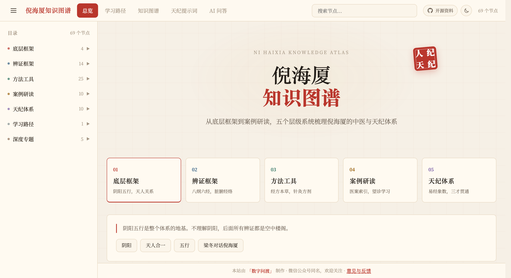
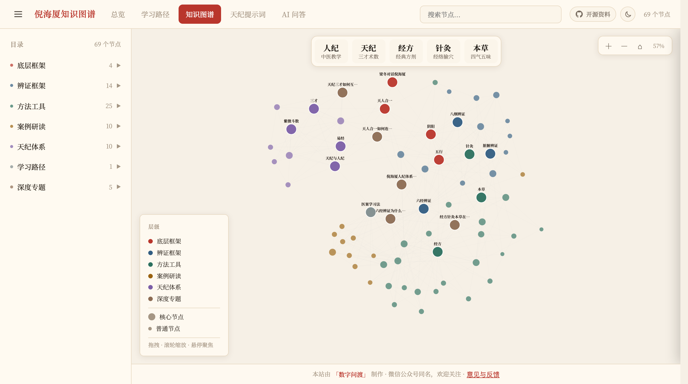

<div align="center">

# 倪海厦知识图谱

**把倪海厦公开讲过的中医（人纪）和易经术数（天纪），整理成一套能在线查关系、能下载离线读、也能直接丢给 AI 的公开资料库。**

[](https://www.nihaixia-knowledge.xyz/)
[](https://www.nihaixia-knowledge.xyz/#/graph)
[](./knowledge/README.md)
[](./LICENSE)

[在线网站](https://www.nihaixia-knowledge.xyz/) · [里头有什么](#里头有什么) · [怎么用](#怎么用) · [天纪 Skill](#在-ai-工具里装天纪提示词) · [目录](#目录) · [边界与版权](#边界与版权)

<br>

<a href="https://www.nihaixia-knowledge.xyz/">
  <picture>
    <source media="(prefers-color-scheme: dark)" srcset="./.github/assets/preview-dark.png">
    
  </picture>
</a>

</div>

---

## 这是什么

倪海厦老师讲过的内容很多，但网上流传的文档往往很零散：几百页的大文档翻不动，扫描件里混着页眉和乱码，学完一本经典也很难把前后的概念串起来。

这个仓库做了两件事：

1. **搭了一个免费在线网站**：把人纪和天纪拆成五个层级、69 个核心节点，配好学习顺序、关系图谱和基于资料库的 AI 问答。
2. **把背后整理的资料全部开源**：所有节点笔记、AI 语料包、去噪分章后的《天纪》《人纪》阅读文本和天纪提示词，都在这个仓库里，拿走就能直接用。

> 国内主站：[www.nihaixia-knowledge.xyz](https://www.nihaixia-knowledge.xyz/) ｜ 腾讯云备用：[CloudBase](https://zeno-d9g0gdvw4a57635c0-1452182285.tcloudbaseapp.com/) ｜ 海外备份：[GitHub Pages](https://zenoyang-ai.github.io/nihaixia-knowledge-graph/)

---

## 里头有什么

按你的目的，直接点对应入口就行：

| 你想做什么 | 点这里 | 里头有什么 |
| --- | --- | --- |
| 先理清脉络、随便逛逛 | [在线网站](https://www.nihaixia-knowledge.xyz/) | 交互式知识图谱、人纪/天纪学习路径、69 个节点详解、5 套天纪提示词、AI 问答 |
| 放进 Obsidian 做笔记 | [`knowledge/01-知识图谱笔记/`](./knowledge/01-知识图谱笔记/README.md) | 与网站同步的 64 张概念卡 + 5 篇专题 + 2 条学习路径，网页能直接读，导入 Obsidian 自带双链 |
| 喂给 NotebookLM / Claude / Dify | [`knowledge/02-AI知识库语料包/`](./knowledge/02-AI知识库语料包/README.md) | 合并单文件 `nihaixia-corpus-all.md`、结构化 `nodes/articles/edges.jsonl` 和提示词合集 |
| 按卷分章读《天纪》《人纪》 | [`03-天纪学习资料/`](./knowledge/03-天纪学习资料/README.md) · [`04-人纪学习资料/`](./knowledge/04-人纪学习资料/README.md) | 保留原文、去掉扫描噪音后拆分（单文件均 ≤ 186 KB）：《天机道》《地脉道》《人间道》《针灸大成》《人纪·针灸篇》《神农本草经》及内经/伤寒/金匮已校勘节选 |
| 在 AI 编程工具里用天纪提示词 | [`skills/nihaixia-tianji/`](./skills/nihaixia-tianji/README.md) | 可直接安装的 Agent Skill，覆盖八字、紫微斗数、易经三才和小六壬 |

<details>
<summary><b>看看交互式知识图谱长什么样（点开看图）</b></summary>
<br>

<picture>
  <source media="(prefers-color-scheme: dark)" srcset="./.github/assets/graph-dark.png">
  
</picture>

</details>

---

## 怎么用

### 1. 网页直接看，或下载到电脑离线看

- **在线使用**：直接打开 [www.nihaixia-knowledge.xyz](https://www.nihaixia-knowledge.xyz/)，支持宣纸浅色和夜读暗色双主题。
- **离线留存**：点本页右上方绿色 **Code** → **Download ZIP**，解压后**直接双击 `docs/index.html`**，就能在浏览器里打开完整的图谱、学习路径和提示词。
  （注：AI 问答依赖云端接口，受浏览器跨域保护，需在线上主站或本地 `http://127.0.0.1:8765` 使用。）

### 2. 丢给 NotebookLM / Claude / Kimi 陪读

下载 [`nihaixia-corpus-all.md`](./knowledge/02-AI知识库语料包/nihaixia-corpus-all.md) 拖进你的 AI 工具，直接这样问：

```text
请只根据我上传的这份倪海厦知识库资料，用通俗的话讲清楚：
1. 为什么人纪推荐从《针灸大成》和《黄帝内经》开始学，而不是上来就背方子？
2. 《伤寒论》里的「六经辨证」和「八纲辨证」是什么关系？
```

如果你在用 Dify、Coze、Cherry Studio 或自己搭 RAG，直接导入同目录下的 [`nodes.jsonl`](./knowledge/02-AI知识库语料包/nodes.jsonl)、[`articles.jsonl`](./knowledge/02-AI知识库语料包/articles.jsonl) 和 [`edges.jsonl`](./knowledge/02-AI知识库语料包/edges.jsonl)。

### 3. 导入 Obsidian 当个人学习库

打开 Obsidian →「打开本地仓库」→ 选中 `knowledge/01-知识图谱笔记/`，从 [`00-知识图谱总览-MOC.md`](./knowledge/01-知识图谱笔记/00-知识图谱总览-MOC.md) 进去就能看到整张双链关系网，全部链接已做零死链校验。

---

## 在 AI 工具里装天纪提示词

如果你在用 **Claude Code / Cursor / Codex / Antigravity**，在终端运行一行命令就能把天纪提示词装进去：

```bash
npx skills add zenoyang-ai/nihaixia-knowledge-graph --skill nihaixia-tianji
```

装好后直接这样说就行：

```text
用倪海厦天纪帮我做一次八字校盘（附你的四柱数据）
用易经三才帮我拆一下要不要换这份工作
按现在时间用小六壬看看今天去谈合作顺不顺
```

Codex 内置脚本安装方式与规则细节见 [`skills/nihaixia-tianji/`](./skills/nihaixia-tianji/README.md)。

---

## 适合谁 / 不在范围内

**适合：**

- 想系统梳理倪海厦人纪和天纪脉络，不想在零散 PDF 里翻来翻去的学习者
- 习惯用 Obsidian 记笔记，或想给 NotebookLM / Dify / Claude 挂一份干净中文资料的人
- 想借这套界面，把自己的读书笔记做成同款双主题知识图谱网站的人

**不在范围内：**

- 拿着古籍里的历史剂量、经方或灸法给自己或家人开方治病（**严禁照方抓药，身体不适请找正规执业医师**）
- 寻找《汉唐方剂讲解》《人纪班闭门课》或具体患者医案全文（本仓库主动不收录）
- 将本仓库整理的资料用于商业售卖、付费打包或课程分发

---

## 目录

```text
nihaixia-knowledge-graph
├── knowledge/                          开源知识库（125 篇 · 约 92 万字）
│   ├── 01-知识图谱笔记/                  69 篇节点与专题 + 学习路径（网页可点 / Obsidian 双链）
│   ├── 02-AI知识库语料包/                单文件全集 + nodes/articles/edges.jsonl + 提示词
│   ├── 03-天纪学习资料/                  天机道、地脉道、人间道（3 卷）、易经64卦图、听课笔记
│   └── 04-人纪学习资料/                  针灸大成（10 卷）、人纪针灸篇（8 章）、神农本草经（5 卷）、经方节选
├── skills/nihaixia-tianji/             天纪提示词 Agent Skill
├── docs/                               图谱静态网站（原生 HTML/CSS/JS + D3.js，双击可离线看）
├── cloudbase/ & miniprogram/           AI 问答 / 反馈 / 统计云函数与微信小程序
└── scripts/ & tests/                   数据校验、知识库同步脚本与测试
```

<details>
<summary><b>想拿这套网站改造成自己的知识图谱？点开看</b></summary>
<br>

静态网站没有任何构建依赖，替换数据就能用：

1. Fork 本仓库，按 [`docs/data/graph.json`](./docs/data/graph.json) 的格式填入你自己的节点、专题和关联关系；
2. 跑一遍校验与资产同步脚本（会自动刷新 Obsidian 笔记、AI 语料包和离线数据包）：
   ```bash
   python3 scripts/build_site_data.py --validate
   python3 scripts/export_knowledge_assets.py
   ```
3. 本地起个简单服务就能预览（部署到 GitHub Pages、CloudBase 或 Vercel 直接指到 `docs/` 即可）：
   ```bash
   python3 -m http.server 8765 --directory docs
   ```

**项目工程说明**：
- `docs/` 推送 `main` 后通过 [deploy.yml](./.github/workflows/deploy.yml) 自动部署至腾讯云 CloudBase，同时同步 GitHub Pages；
- `cloudbase/` 包含 AI 问答、飞书反馈与访问统计云函数（说明见 [ANALYTICS.md](./docs/ANALYTICS.md) 与 [FEEDBACK_REAL_API.md](./docs/FEEDBACK_REAL_API.md)），所有密钥均存于平台环境变量与 GitHub Secrets，不进代码仓库。

</details>

---

## 边界与版权

- **代码与脚本**：[MIT License](./LICENSE)
- **本站原创的图谱卡片、专题文章、学习路径与提示词**：[CC BY-SA 4.0](https://creativecommons.org/licenses/by-sa/4.0/)
- **古籍与原著归属**：明·杨继洲《针灸大成》及古代医经原典属于公有领域；涉及倪海厦先生著作、批注与课堂讲授的内容，著作权归**倪海厦先生**及其权利继承人所有，本仓库仅作去噪清洗与分章整理，供个人非商业学习。
- **使用边界**：文献中保留的历史剂量、附方与灸法表述仅为原文原貌，不构成个人用药或医疗建议；天纪相关内容仅作思维参考，不作为重大人生决策依据。详见 [内容声明](./CONTENT_NOTICE.md) 与 [开源资料声明](./knowledge/LICENSE.md)。如权利方有任何异议，请通过 GitHub Issues 联系，核实后 7 个工作日内移除。

---

<div align="center">

<sub>如果这份整理帮到了你，点个 ⭐ 就是最好的反馈</sub>

</div>
